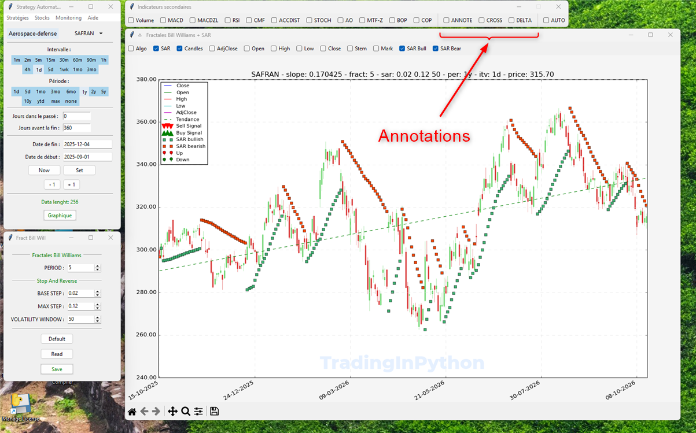
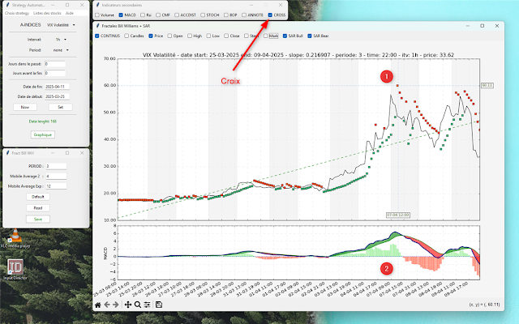
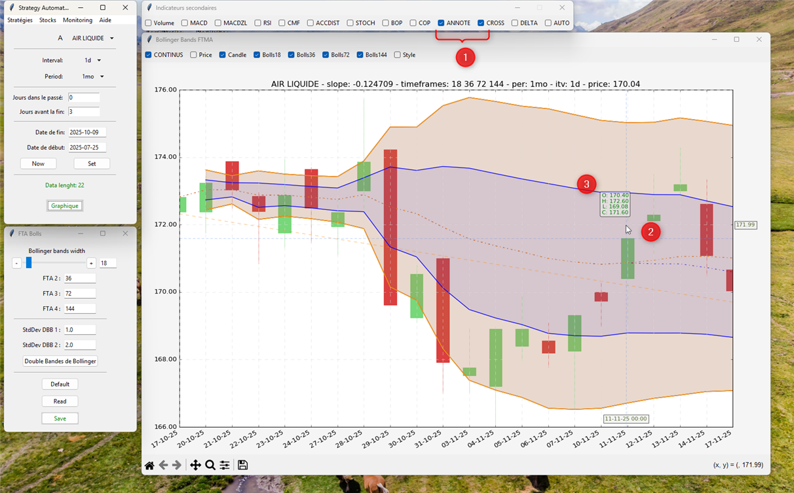
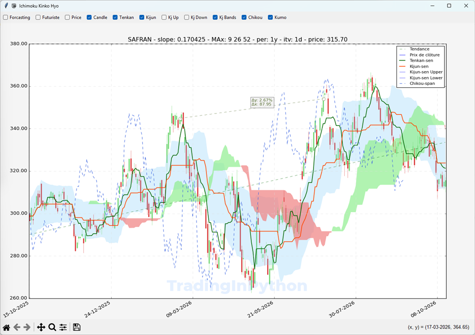
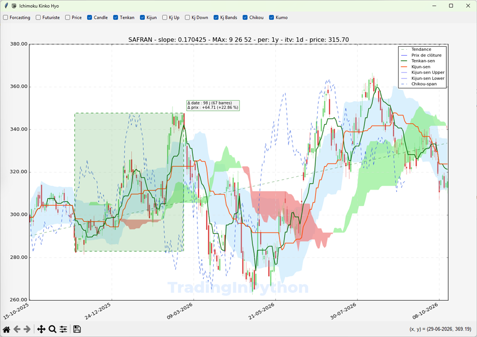

# Annoter les graphes

Vous avez plusieurs types d'annotations dynamiques qui suivent le pointeur de la souris :

<figure style="text-align: center;">
    
    <figcaption><em>AIR LIQUIDE</em></figcaption>
</figure>

La première en cliquant la case à cocher {{ "ANNOTE" | keywordi }} une annotation suit votre souris pour vous indiquer la date et le cours de l'action à l'endroit de votre souris.

La deuxième en cliquant sur {{ "CROSS" | keywordi }} annotation en croix, projette le cours et la date sur les bords du graphe à l'endroit de votre souris :

<figure style="text-align: center;">
    
    <figcaption><em>AIR LIQUIDE</em></figcaption>
</figure>

- {{ "(1)" | red }} La croix vous permet de mettre en évidence les résistance et les supports du cours de l'action.

- {{ "(2)" | red }} La barre verticale se poursuit dans les graphes secondaires.

En positionnant la croix exactement à l'endroit où vous le souhaitez et en utilisant la touche : <kbd>V</kbd> comme dans [Annoter les prix et les dates](./annote-price-date.md) vous pouvez marquer les résistances et les supports du cours de l'action.

Pour stopper les annotations et les {{"effacer"|keyword}}, {{ "décochez" | keyword }} simplement les cases à cocher correspondante.

## Annotation Prix et Date

Cochez les {{"deux cases"|keyword}}, pour avoir à la fois le prix qui suit la souris et la date correspondante.

<figure style="text-align: center;">
    
    <figcaption><em>AIR LIQUIDE</em></figcaption>
</figure>

- {{ "(1)" | red }} Les deux case {{ "ANNOTE" | keywordi }} et {{ "CROSS" | keywordi }} sont cochées.
- {{ "(2)" | red }} La croix prix/date s'affiche sur le graphe.
- {{ "(3)" | red }} L'annotation OHLC s'affiche sur la bougie.

## Annotation en Delta

Cochez la case {{"DELTA"|keywordi}} pour afficher une annotion en delta qui vous affiche le delta en date et en prix entre deux points.

- {{"Premier clic gauche"|keyword}} pour affiche un premier point qui s'aligne sur la courbe de prix.
- {{"Deuxième clic gauche"|keyword}}, un deuxième point s'affiche, il s'aligne sur la courbe de prix et l'annotation en delta s'affiche.

<figure style="text-align: center;">
    
    <figcaption><em>SAFRAN</em></figcaption>
</figure>

Pour {{"effacer"|keyword}} l'annotation en delta, faites un clic droit.

???+ warning

    Attention pour les gauchés c'est inversé !

## Annotation en Rectangle

Si aucun des outils de la {{"barre d'outils de MatPlotlib"|keyword}} n'est coché, vous pouvez sélectionner un rectangle avec la souris qui affichera une annotion Delta date, Delta prix.

Rectangle {{"vert"|green}} pour les hausses.  
Rectangle {{"rouge"|red}} pour les baisses.

<figure style="text-align: center;">
    
    <figcaption><em>SAFRAN</em></figcaption>
</figure>

Pour {{"effacer"|keyword}} l'annotation refaites un clic.
