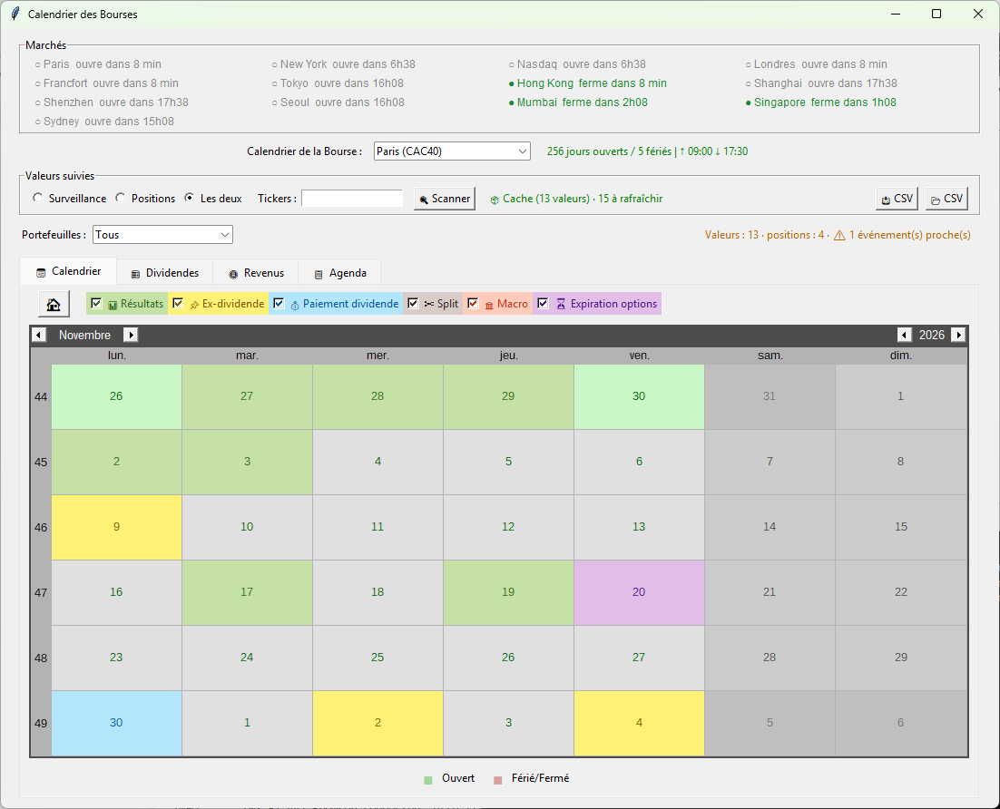
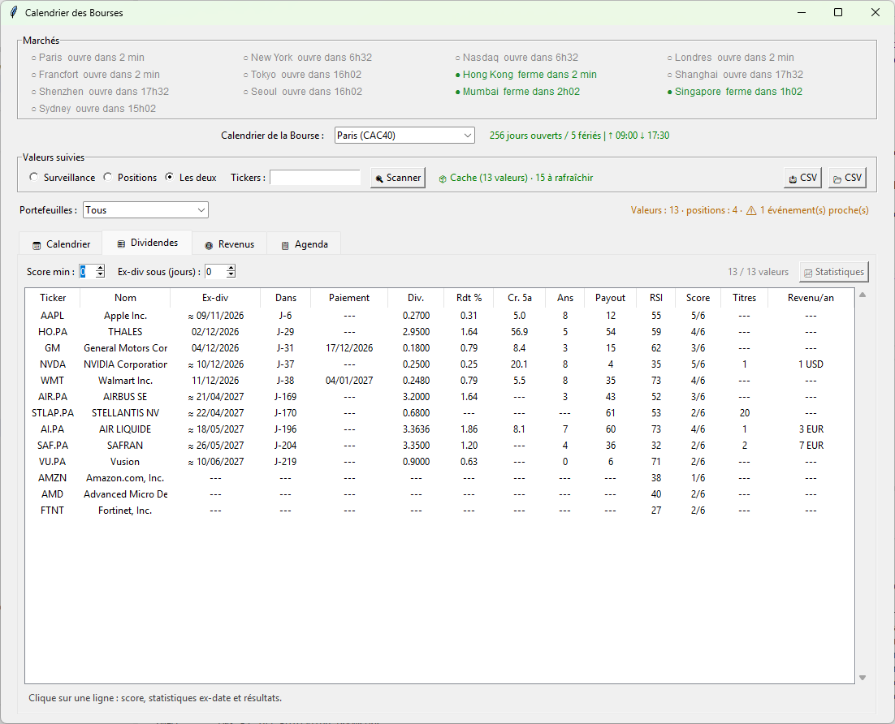
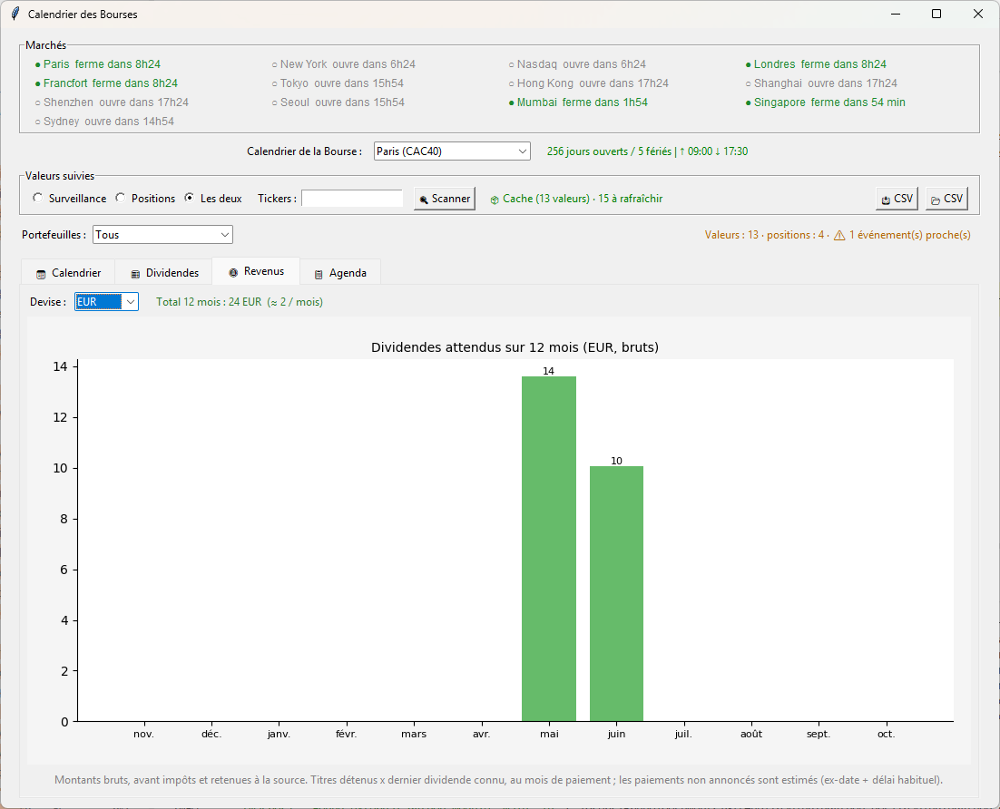

# Calendrier des marchés financiers

Voici une fonctionnalité dont nous avons l'utilité au sein de la plateforme pour ne pas avoir à chercher trop loin sur le Web.

Le Calendrier répond à trois questions que se pose tout trader :

- {{"Les marchés sont-ils ouverts ?"|keyword}}
- {{"Que va-t-il se passer sur mes actions dans les prochains jours ?"|keyword}} (dividendes, résultats, splits, expirations d'options, publications macro)
- et {{"combien vais-je toucher en dividendes ?"|keyword}}

## Le Marché est-il ouvert ou fermé ?

Si vous êtes passionné de trading, vous avez très certainement vécu cette situation.

Vous vous levez avec l'espoir de réussir un bon trade, vous avez repéré une stock que vous aimeriez trader, seulement voilà à {{"9:01"|keyword}} il ne se passe toujours rien !

Le marché semble figé car il est ... fermé et oui, on ne vous avait pas prévenu mais aujourd'hui pas de Bourse, pas de trade.

Pour éviter des déconvenues, le Calendrier est là pour vous donner cette information : le marché va-t-il ouvrir ou bien est-ce un jour Off ? Quels sont les prochains jours où le marché est fermé ?

<figure style="text-align: center;">
    <a href="/images/market-calendar/market-calendar.png" class="glightbox" data-gallery="galerie" title="Calendier des marchés financiers">
        
    </a>
    <figcaption><em>Calendier des marchés financiers</em></figcaption>
</figure>

### L'horloge des marchés

L'encadré {{"Marchés"|keywordi}}, en haut de la fenêtre, affiche l'état de tous les marchés en même temps, avec un compte à rebours. Il se met à jour toutes les 30 secondes.

| Pastille | Couleur | Signification |
|---|---|---|
| ● | vert | marché ouvert, avec l'heure de fermeture (*ferme dans 2h23*) |
| ◐ | orange | pause déjeuner (Tokyo, Hong Kong, Shanghai), avec l'heure de reprise |
| ○ | gris | marché fermé, avec l'heure de la prochaine ouverture (*ouvre lun. 02/11 09:00*) |

Les **séances raccourcies** (veille de Noël, lendemain de Thanksgiving...) sont signalées quand le marché est ouvert.

Il y a quelques marchés disponibles :

- Paris (CAC40)
- New York (NYSE)
- Nasdaq
- Londres
- Francfort
- Tokyo (Nikkei 225)
- Hong Kong (Hang Seng)
- Shanghai (SSE Composite) **Chine continentale**
- Shenzhen (SZSE Composite) **Chine continentale**
- Seoul (KOSPI) **Corée du Sud**
- Mumbai (SENSEX) **Inde**
- Singapore (STI) **Singapour**
- Sydney (ASX 200) **Australie (Asie-Pacifique)**

### Le calendrier d'une bourse

Choisissez une bourse dans la liste {{"Bourse du calendrier"|keywordi}}. Le calendrier colore chaque jour de semaine :

- {{"vert"|green}} : séance passée (ou aujourd'hui si le marché est ouvert en ce moment),
- **gris** : séance à venir,
- {{"rouge"|red}} : jour férié ou marché fermé (aujourd'hui, si le marché est fermé).

À droite du sélecteur, la ligne de statut résume l'année et les horaires du jour, {"en heure locale de la place"|keyword}} : *256 jours ouverts / 5 fériés | ↑ 09:00 ↓ 17:30*.

Survolez un jour avec la souris pour voir ses horaires d'ouverture, la pause déjeuner s'il y en a une, et tous les événements de ce jour. Quand vous changez d'année avec les flèches du calendrier, les séances et les événements sont rechargés.

## Les événements du calendrier

En plus des jours d'ouverture, le calendrier affiche les événements de vos valeurs. Chaque type a sa couleur, et les cases **Afficher** vous permettent de masquer ceux qui ne vous intéressent pas.

| Type | Couleur | Ce que c'est |
|---|---|---|
| 📊 Résultats | vert | publication des résultats trimestriels |
| 📌 Ex-dividende | jaune | date d'exclusion du dividende |
| 💰 Paiement dividende | bleu | date de versement du dividende |
| ✂ Split | marron | division du nombre d'actions |
| 🏛 Macro | orange | publication économique (inflation US, emploi US, FOMC...) |
| ⏳ Expiration options | violet | expiration mensuelle des options, *triple witching* en mars, juin, septembre et décembre |

Quand plusieurs événements tombent le même jour, la couleur affichée suit l'ordre de priorité Résultats, puis Ex-dividende, Paiement, Split, Macro, Expiration. Le survol de la date les liste tous.

!!! info "Dates estimées"
    Une date précédée de **≈** (ou marquée *estimé*) n'est pas annoncée par l'entreprise : elle est déduite du rythme habituel des dividendes (trimestriel, semestriel, annuel). Une date sans **≈** vient de la source de données.

### La date d'exclusion

La date d'exclusion (*ex-dividende*) est la date à partir de laquelle (ex comme exclusion) :

- si vous achetez l'action ce jour-là ou après, vous n'avez **pas** droit au prochain dividende,
- si vous voulez toucher le dividende, vous devez détenir l'action **avant** cette date.

### Les expirations d'options

Elles tombent le troisième vendredi de chaque mois. Si ce vendredi est férié à New York (Vendredi saint), l'expiration est avancée au jeudi.

### Les publications macro

Elles proviennent de deux sources :

- le fichier `calendar-macro.json`, que vous tenez à jour vous-même (FOMC, BCE...),
- les publications **CPI** (inflation US) et **emploi US (NFP)** de la FRED, si une clé API FRED est configurée.

Le fichier se trouve dans le même répertoire que le fichier de scanning (voir plus bas). Chaque événement est une date et un libellé :

```json
[
  { "date": "2026-12-09", "label": "FOMC" },
  { "date": "2026-12-17", "label": "BCE" }
]
```

## Les valeurs suivies

Le cadre {{"Valeurs suivies"|keywordi}} définit ce qui est scanné :

- **Surveillance** : la liste de actions du fichier *calendar-dividendes.json*,
- **Positions** : les actions que vous détenez, calculées à partir de vos portefeuilles,
- **Les deux** : l'union des deux.

### Le fichier de scanning : calendar-dividendes.json

C'est la liste des actions à scanner.

Ce fichier se trouve dans le répertoire suivant :

- **C:\Users\\{Nom d'utilisateur}\AppData\Local\TradingInPython\screeners\calendar-dividendes.json**

C'est lui que vous manipulez avec la fonction [Gestion des liste d'actions](https://trading-in-python.sodevlog.com/gestion-liste-actions/).

Vous ouvrez ce fichier pour ajouter ou supprimer des actions à surveiller.

### Les positions : vos portefeuilles

<!-- À VÉRIFIER : chemin réel du dossier portfolios dans l'installation -->

Le Calendrier lit les **transactions** des fichiers `.json` placés dans le dossier **portfolios** : ce sont les fichiers du [Gestionnaire de Portefeuilles](https://trading-in-python.sodevlog.com/portfolio-manager/). Chaque fichier est une liste de transactions :

```json
[
  {
    "type": "achat",
    "ticker": "EL.PA",
    "name": "ESSILORLUXOTTICA",
    "quantity": 5.0,
    "price": 174.55,
    "date": "20-05-2026",
    "fees": 0.0,
    "total": 872.75
  },
  {
    "type": "vente",
    "ticker": "NVDA",
    "quantity": 1.0,
    "price": 180.0,
    "date": "19-05-2026"
  }
]
```

Les règles de calcul :

- un **achat** ajoute des titres, une **vente** en retire,
- les transactions datées **après aujourd'hui** sont ignorées,
- une position à zéro (ou négative) n'est pas comptée,
- la date s'écrit **JJ-MM-AAAA**.

Le menu {{"Portefeuille"|keywordi}} (à droite de la ligne de statut) permet de choisir un seul fichier, ou {{"Tous"|keywordi}} pour cumuler l'ensemble. Un nouveau fichier déposé dans le dossier apparaît dans le menu au scan suivant.

### Tickers

Le champ {{"Tickers"|keywordi}} vous permet de scanner également des tickers sans passer par la liste de `calendar-dividendes.json` pour un scan rapide si vous en avez besoin. Séparez-les par des virgules : `AI.PA, KO, MSFT`. Quand ce champ est rempli, il remplace la liste choisie pour le scan.

## Le scan

Quand vous cliquez sur le bouton {{"Scanner"|keywordi}}, le scan démarre pour aller chercher les data. Il tourne en arrière-plan : vous pouvez continuer à utiliser la plateforme, et la progression s'affiche (*3/8 · MSFT*).

<figure style="text-align: center;">
    <a href="/images/market-calendar/market-calendar-scan.png" class="glightbox" data-gallery="galerie" title="Calendier des marchés financiers - Scan des dividendes">
        
    </a>
    <figcaption><em>Calendier des marchés financiers - Scan des dividendes</em></figcaption>
</figure>

À la fin, la ligne de statut résume le résultat : *✅ 8 valeur(s)*. Si certains tickers n'ont pas pu être récupérés (ticker inconnu, pas d'historique), ils sont **listés** : *⚠ 1 en erreur : XXX*. Ils ne disparaissent plus en silence.

!!! tip "Pas besoin de rescanner à chaque fois"
    Le résultat du dernier scan est conservé. À l'ouverture du Calendrier, le tableau s'affiche **immédiatement** (*📦 Cache*). Les valeurs scannées il y a plus de 12 heures sont signalées *à rafraîchir*.

Les données viennent de Yahoo Finance.

## Le tableau des dividendes

Le résultat du scan affiche les actions de la liste dans le tableau. Cliquez sur un en-tête pour trier (un deuxième clic inverse l'ordre). Les valeurs sans information sont toujours en bas.

| Colonne | Signification |
|---|---|
| Ticker, Nom | l'action |
| Ex-div | date d'exclusion des dividendes, si vous achetez à cette date c'est trop tard pour toucher un dividende (**≈** = date estimée) |
| Dans | nombre de jours avant l'ex-date (*J-2*, *Auj.*, *J+3* si elle est passée) |
| Paiement | date de versement du dividende, quand elle est connue |
| Div. | montant du dernier dividende par action |
| Rdt % | **rendement actuel** : dividendes des 12 derniers mois divisés par le cours |
| Cr. 5a | croissance annuelle moyenne du dividende sur 5 ans, en % |
| Ans | nombre d'années consécutives sans baisse du dividende (sur 10 ans au maximum, avec une tolérance de 1 %) |
| Payout | part du bénéfice distribuée en dividende, en % |
| RSI | RSI à 14 jours |
| Score | score sur 6 (voir ci-dessous) |
| Titres | nombre de titres détenus (d'après vos portefeuilles) |
| Revenu/an | titres détenus × dividendes des 12 derniers mois |

!!! note "Évolution"
    L'ancienne colonne "Rdt moy 5a" (rendement moyen sur 5 ans) est remplacée par **Rdt %**, le rendement actuel, et **Cr. 5a**, la croissance du dividende.

En cliquant sur une des lignes du tableau, le calendrier se positionne sur la date et le détail de la valeur s'affiche sous le tableau : score, statistiques de l'ex-date et des résultats.

### Filtrer

- **Score min** : n'affiche que les valeurs ayant au moins ce score.
- **Ex-div sous (jours)** : n'affiche que les valeurs dont l'ex-date tombe dans les N prochains jours (0 = toutes).

Combinés, ils répondent à des questions comme *« quelles valeurs de ma liste détachent leur dividende d'ici 10 jours avec un score d'au moins 4 ? »*.

### Le score sur 6

Un point par critère rempli, affichés dans cet ordre par des ✔ et des ✘ :

| # | Critère | Seuil par défaut |
|---|---|---|
| 1 | Rendement | entre 2 % et 8 % (au-delà, c'est souvent un piège à rendement) |
| 2 | Croissance du dividende sur 5 ans | au moins 2 % par an |
| 3 | Années sans baisse | au moins 5 |
| 4 | Payout | 75 % au plus |
| 5 | Tendance | cours au-dessus de sa moyenne mobile 200 jours |
| 6 | RSI | 60 au plus (pas de surachat) |

Ce score est un {{"repère de lecture"|keyword}}, pas un conseil d'investissement.

## Les statistiques de l'historique

Double-cliquez sur une ligne (ou cliquez sur **Statistiques**) pour analyser comment la valeur se comporte autour de ses dates clés.

### À l'ex-date

Le jour où l'action détache son dividende, son cours baisse en théorie du montant du dividende. Les statistiques mesurent ce qui se passe réellement :

- la **chute médiane** du cours, exprimée en multiple du dividende (1,0 = le cours baisse exactement du dividende),
- le **délai de recouvrement** : en combien de jours de bourse le cours retrouve son niveau d'avant l'ex-date,
- la part des cas où il n'est **pas retrouvé** en 60 jours de bourse.

### Dividend capture

Le tableau simule la stratégie qui consiste à **acheter la veille de l'ex-date** et à revendre N jours de bourse après, pour chaque ex-date passée de la valeur.

| Colonne | Signification |
|---|---|
| Détention (j) | nombre de jours de bourse entre l'ex-date et la vente |
| Obs. | nombre de dividendes passés testés |
| Gagnants % | part des opérations gagnantes |
| Net moy % / Net méd % | résultat moyen / médian, **dividende compris** |
| Prix seul moy % | résultat moyen **sans** le dividende |

L'écart entre « Net » et « Prix seul » est le dividende réellement capté. Si « Prix seul » est négatif, c'est le cours qui a absorbé le dividende.

!!! warning "Précautions"
    Ces statistiques sont calculées sur le passé, **hors frais et hors impôts**. Des rendements passés ne garantissent pas les rendements futurs.

### Les résultats trimestriels

Pour chaque publication passée, la plateforme mesure le mouvement du cours le jour de la réaction (le jour même si la publication a lieu avant l'ouverture, la séance suivante si elle a lieu après la clôture) : mouvement médian (±), part de hausses, et les 4 derniers mouvements. Utile pour savoir à quel point une valeur est secouée avant de la garder en portefeuille pendant une publication.

## Les revenus de dividendes

L'onglet **Revenus** affiche, sur un histogramme, les dividendes que vous devriez toucher sur les **12 prochains mois**, mois par mois : titres détenus × dernier dividende connu, au mois du paiement.

<figure style="text-align: center;">
    <a href="/images/market-calendar/market-calendar-revenus.png" class="glightbox" data-gallery="galerie" title="Calendrier des marchés financiers - Revenus de dividendes">
        
    </a>
    <figcaption><em>Calendrier des marchés financiers - Revenus de dividendes</em></figcaption>
</figure>

- Si vous détenez des actions dans plusieurs devises, choisissez la **devise** à afficher : les montants ne sont jamais additionnés entre devises.
- Les montants sont **bruts**, avant impôts et retenues à la source.
- Les paiements non annoncés sont **estimés** (ex-date + délai habituel).

## L'agenda

L'onglet {{"Agenda"|keywordi}} liste les prochains événements dans l'ordre : date, délai, type, ticker et détail. 

L'horizon est de 60 jours, modifiable.

La case {{"Positions seulement"|keywordi}} ne garde que les actions que vous détenez (les événements généraux, macro et expirations, restent). 

Un clic sur une ligne positionne le calendrier sur la date.

De retour sur le calendrier le bouton 🏠 Home ou Maison vous permet de retrouver la date du jour.

## Dans la fenêtre principale

<!-- À PUBLIER une fois EventBanner et EventMarkers intégrés à la fenêtre principale et au graphique -->

### Le bandeau d'alertes

Un bandeau affiche, dès l'ouverture de la plateforme, les événements imminents de vos valeurs :

*📅 Résultats KO · demain | Ex-dividende TTE.PA 1.0500 · J-2*

| Événement | Prévenu |
|---|---|
| Ex-dividende, résultats, split | 3 jours avant |
| Expiration d'options, publication macro | la veille |

Un clic sur le bandeau ouvre le Calendrier.

### Les repères sur le graphique

Sur le graphique d'une action, des repères verticaux marquent les événements de la valeur : **D** pour les ex-dividendes, **R** pour les résultats, **S** pour les splits. Un trait en pointillés indique une date estimée.

## Fichiers de sauvegarde au format CSV

Deux boutons :

- {{"Export CSV"|keywordi}} : Pour sauver votre scan au format CSV.
- {{"Import CSV"|keywordi}} : Pour importer un scan auparavant effectué et sauvé.

Ainsi si vous avez de très grandes listes d'actions à surveiller vous n'êtes pas obligé de réeffectuer le scan.

!!! note
    Le CSV contient le tableau, pas l'historique des cours : après un import, les **statistiques** et les **dividendes projetés au-delà du prochain** ne sont pas disponibles. Relancez un scan pour les retrouver.

## Où sont les fichiers ?

| Fichier | Rôle |
|---|---|
| `calendar-dividendes.json` | liste des actions à surveiller |
| `calendar-macro.json` | vos publications macro (FOMC, BCE...) |
| `calendar-events-cache.json` | dernier scan, pour un affichage immédiat |
| `portfolios/*.json` | vos transactions, d'où sont déduites les positions |

Les trois premiers sont dans le répertoire :

- `C:\Users\{Nom d'utilisateur}\AppData\Local\TradingInPython\screeners\`.

## À savoir

- Les données viennent de Yahoo Finance : elles peuvent être absentes, en retard ou corrigées après coup. Vérifiez une date importante auprès de l'émetteur.
- Les dates marquées {{"≈"|keyword}} sont des estimations.
- Les actions cotées en pence (Londres) affichent leurs montants en {{"GBp"|keyword}}, pas en livres.

_Rien de tout cela n'est un conseil en investissement._
