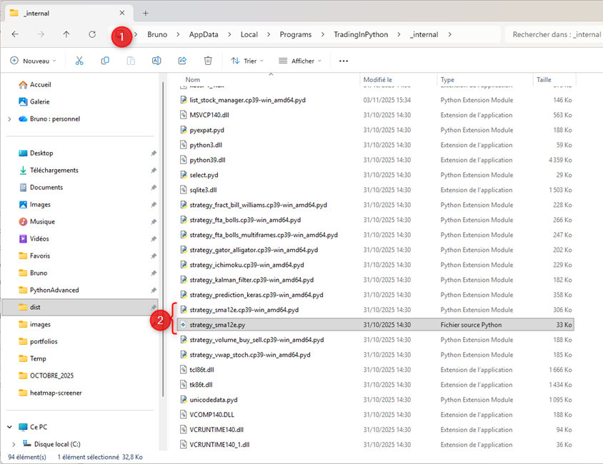

# Open Software : une plateforme de trading ouverte et extensible avec Python

{{ "TradingInPython" | keyword }} est un logiciel d'analyse technique conçu pour être utilisé immédiatement, mais aussi pour être adapté par les utilisateurs qui souhaitent aller plus loin.

Vous pouvez exploiter les indicateurs et les stratégies disponibles sans programmer. Si vous connaissez Python, vous pouvez également **consulter certains codes sources publiés, exécuter vos propres scripts et développer vos propres stratégies de trading**.

Cette approche fait de TradingInPython un environnement ouvert et extensible : vous commencez avec les fonctionnalités de la plateforme, puis vous pouvez progressivement ajouter vos propres outils.

!!! info "Open Software ne signifie pas Open Source"

    TradingInPython n'est pas intégralement distribué sous licence Open Source. Le code source de certains composants et algorithmes est publié, tandis que le logiciel complet conserve des éléments propriétaires. L'ouverture concerne notamment les algorithmes publiés et les possibilités d'extension en Python.

## Les algorithmes de traitement du signal publiés sur GitHub

Une partie des algorithmes de traitement du signal utilisés par la plateforme est accessible publiquement. Vous pouvez consulter leur code, comprendre leur fonctionnement et vous en inspirer pour vos propres développements.

<figure style="text-align: center;">
  <a href="https://github.com/SoDevLog/PyTrading/tree/main/TradingInPython/_internal/digitsignalprocessing" target="_blank" title="GitHub - Digital Signal Processing">
    
  </a>
  <figcaption><em>Les sources Digital Signal Processing publiées sur GitHub</em></figcaption>
</figure>

Le répertoire **Digital Signal Processing** rassemble des algorithmes écrits en {{ "Python" | g_tooltip }} utilisés dans les traitements et les indicateurs de la plateforme :

- [Consulter le répertoire Digital Signal Processing sur GitHub](https://github.com/SoDevLog/PyTrading/tree/main/TradingInPython/_internal/digitsignalprocessing)
- [Consulter le fichier `indicators.py`](https://github.com/SoDevLog/PyTrading/blob/main/TradingInPython/_internal/digitsignalprocessing/indicators.py), qui regroupe notamment des implémentations d'indicateurs techniques.

Vous pouvez ainsi examiner le code plutôt que de considérer les indicateurs comme des outils entièrement opaques. Ces sources constituent également des exemples pour apprendre à construire vos propres traitements de données financières.

## Exécuter vos propres scripts Python dans TradingInPython

Il n'est pas nécessaire de modifier les fichiers internes du logiciel pour commencer à développer vos outils. La plateforme intègre un **interpréteur de scripts Python** qui permet de lancer des scripts utilisateurs depuis son interface.

Cette solution permet notamment de :

- exécuter les scripts Python fournis avec la plateforme,
- analyser une valeur ou une liste d'actions sélectionnée,
- exploiter les informations transmises par la plateforme à travers son API de scripts,
- afficher les résultats dans la console et produire vos propres analyses.

Les listes d'actions constituées avec les screeners peuvent notamment servir de données d'entrée à vos scripts. Vous pouvez donc associer sélection de valeurs, analyse financière et programmation Python dans un même environnement.

Pour découvrir le fonctionnement de cette interface, les scripts fournis et l'API disponible, consultez la documentation :

- [Comment utiliser l'interpréteur de scripts Python](https://trading-in-python.sodevlog.com/script-interpreter/interface/)
- [Scripts d'analyse financière](https://trading-in-python.sodevlog.com/script-interpreter/financial-analysis-scripts/)
- [Exemples de scripts utilisateurs sur GitHub](https://github.com/SoDevLog/PyTrading/tree/main/TradingInPython/_internal/user_scripts)

Sur une installation Windows, les scripts utilisateurs sont notamment regroupés dans le répertoire `user_scripts` du dossier de données de TradingInPython, sous le profil de l'utilisateur :

```text
C:\Users\{UserName}\AppData\Local\TradingInPython\user_scripts
```

## Modifier une stratégie Python existante

Pour les utilisateurs qui souhaitent intervenir plus directement sur une stratégie livrée avec le logiciel, certains fichiers Python peuvent être étudiés et adaptés.

Prenons l'exemple de la stratégie des moyennes mobiles :

<figure style="text-align: center;">
  <a href="/images/open-software/sources-python.png" target="_blank" title="Fichiers Python de la stratégie des moyennes mobiles">
    
  </a>
  <figcaption><em>Exemple de fichiers associés à une stratégie Python</em></figcaption>
</figure>

Le dépôt GitHub contient notamment le fichier source de cette stratégie :

- [`strategy_sma12e.py` sur GitHub](https://github.com/SoDevLog/PyTrading/blob/main/TradingInPython/_internal/strategy_sma12e.py)

Lorsque votre installation contient à la fois le fichier Python et le module compilé correspondant, le fonctionnement dépend de la version distribuée :

- le fichier `.py` contient le script Python lisible et modifiable ;
- le fichier `.pyd` est un module d'extension compilé, notamment à l'aide de Cython.

Dans le mécanisme décrit pour cette stratégie, si vous souhaitez tester votre version du script, vous pouvez modifier le fichier `.py` et mettre temporairement de côté le module `.pyd` correspondant afin que Python charge le script source à la place.

Le nom exact du fichier `.pyd` dépend de la version de Python et de l'environnement de compilation. Un nom contenant `cp39`, par exemple, correspond à une ancienne génération CPython 3.9 : **ne recopiez pas ce nom sans vérifier les fichiers présents dans votre propre installation**.

!!! danger "Précautions avant toute modification"

    - Faites une sauvegarde de votre installation avant de modifier un fichier interne.
    - Ne déplacez que le module compilé correspondant exactement au script que vous souhaitez remplacer.
    - Conservez une copie du fichier d'origine afin de pouvoir revenir en arrière.
    - Une mise à jour ou une réinstallation de la plateforme peut remplacer vos modifications.

Vous pouvez également cloner le dépôt du projet pour travailler sur les fichiers sources dans un environnement de développement séparé :

- [Dépôt GitHub SoDevLog/PyTrading](https://github.com/SoDevLog/PyTrading)

## Développer vos propres stratégies de trading

L'interpréteur de scripts est un premier moyen de personnaliser vos analyses. Pour aller plus loin, TradingInPython met à disposition une API permettant de développer des stratégies et d'exploiter les données fournies par la plateforme.

Vous pouvez découvrir les principes de création des stratégies, consulter les exemples disponibles et adapter votre approche à vos propres règles d'analyse :

- [Vue d'ensemble des stratégies de trading](https://trading-in-python.sodevlog.com/strategies/)
- [Documentation de l'interpréteur et de l'API des scripts](https://trading-in-python.sodevlog.com/script-interpreter/interface/)
- [Exemple de stratégie des moyennes mobiles](https://github.com/SoDevLog/PyTrading/blob/main/TradingInPython/_internal/strategy_sma12e.py)

Si vous souhaitez disposer d'un environnement de développement et accéder à un périmètre plus large de sources, consultez également la présentation du Kit :

- [Kit de Trading en Python et Data Analyses](https://www.trading-et-data-analyses.com/p/trading-et-data-analyses-en-langage.html)

Le Kit constitue une offre distincte de l'application prête à l'emploi. Consultez sa présentation pour connaître précisément son contenu et ses modalités.

## Besoin d'informations ou d'accompagnement ?

Vous souhaitez développer une stratégie de trading technique, comprendre les possibilités d'extension ou obtenir des précisions sur le Kit de développement ?

- [Contacter le support de TradingInPython](https://www.trading-et-data-analyses.com/p/formulaire-de-contact.html)
